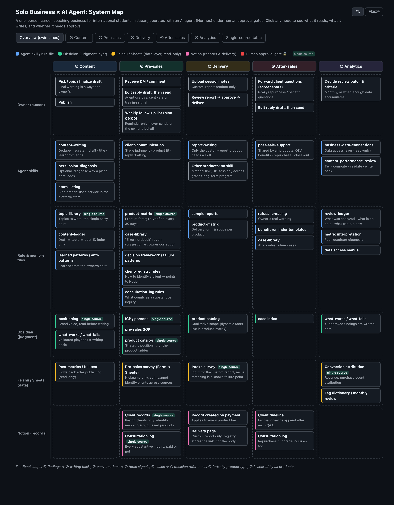
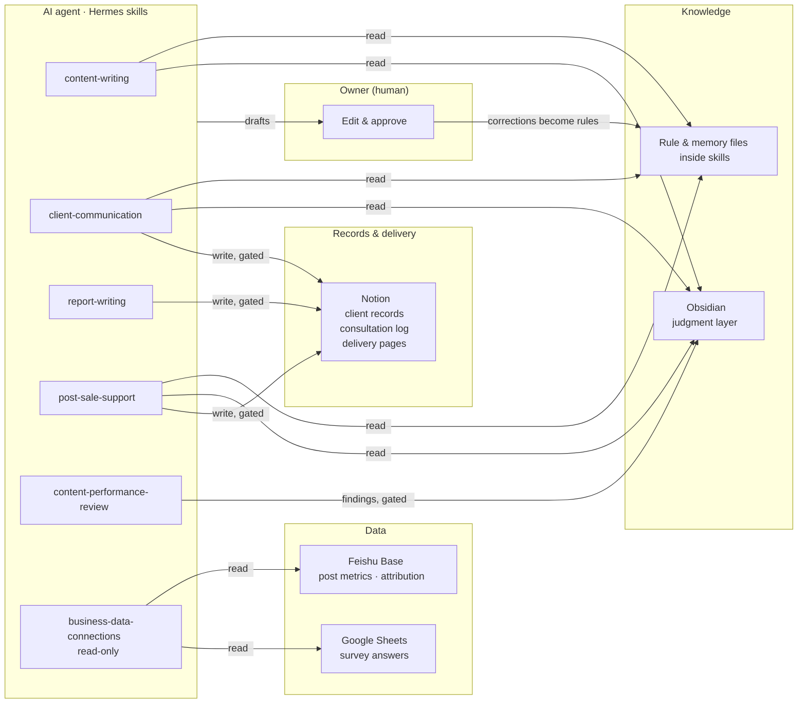

# Solo Business × AI Agent: System Design

**English** | [日本語](#日本語)

How I run a one-person career-coaching business (for international students job-hunting in Japan) with an AI agent, without letting the agent make decisions that should stay with a human.

**▶ Interactive system map:** [li-yiqian.github.io/solo-business-agent-system](https://li-yiqian.github.io/solo-business-agent-system/) (EN / 日本語 toggle; click any node to see what it reads, what it writes, and whether it needs approval)



> This repository shows the **architecture and operating rules** only. Client data, pricing, sales playbooks and the actual skill files are intentionally excluded.

---

## The problem

A solo operator handles content, sales conversations, delivery, after-sales support and analytics, all part-time. An LLM agent can draft most of this work. Left unconstrained, though, it will:

- answer a client from a stale copy of a fact (an old link, an outdated price),
- "recognize" a returning client by similarity and give advice to the wrong person,
- draw conclusions from a handful of posts and rewrite the playbook around noise,
- promise to "follow up later" when it has no persistent process to do so.

The system is designed around those failure modes.

## Architecture



Five business stages, each with its own flow:

| Stage | What the agent does | Where a human must approve |
|---|---|---|
| ① Content | Dedupe topics, draft, log to an index | Final wording; writing back learned patterns |
| ② Pre-sales | Identify client, judge stage, check product fit, draft reply | Identity confirmation, every sent message, rule write-backs |
| ③ Delivery | Create client record, draft custom report | Report before it is written to Notion |
| ④ After-sales | Classify each question against product scope, draft reply | Every sent message, case-library entries |
| ⑤ Analytics | Fetch (read-only), apply sample gates, grade findings | Any write-back to the playbook |

The stages form a loop: analytics findings feed writing, sales conversations feed topics, after-sales cases feed sales judgment.

## Design principles

1. **Single source of truth per fact.** Every fact (product facts, client identity, revenue, topics to write) lives in exactly one place, and the agent must read it from there rather than from memory. A lookup table in the system map lists every fact and its source.
2. **Human approval gates at irreversible points.** The agent drafts, and the owner edits and sends. Writes to client records or the playbook need explicit, per-instance approval. Purely objective log entries are auto-written and then read back for verification.
3. **Identity before advice.** If a message refers to a specific person, the agent must find them in the client records and state *"I believe this is X, based on ⟨field⟩"* before it gives any advice. A "similar" client is never used as a substitute.
4. **Read-only data layer.** Analytics sources are read through a single read-only access layer. Identities are never matched across sources at that layer.
5. **Learn from the owner's edits, not from guesses.** The difference between the agent's draft and what was actually sent is training signal. Explicit corrections become rules (after approval). Lessons the agent infers on its own are marked "unverified" until the owner confirms them.
6. **Rules must have an execution path.** The agent only runs when a conversation starts. Anything that depends on "remembering later", such as weekly follow-ups, is moved into a scheduled script instead of written as a rule nobody will trigger.
7. **Statistical humility.** Analytics apply hard gates before drawing conclusions: below the reach baseline → no judgment, n < 5 → "watch" only, and conversion content is never judged by save rate. Metric priority is conversion > saves > CTR.

## Stack

| Layer | Tool |
|---|---|
| Agent runtime | [Hermes Agent](https://hermes-agent.nousresearch.com/) (skills = Markdown rule files + Python scripts) |
| Judgment layer | Obsidian (positioning, ICP, validated content patterns) |
| Data layer | Feishu Base (post metrics, conversion attribution), Google Sheets (survey answers) |
| Records & delivery | Notion (client records, consultation log, delivery pages) |
| Scheduling | Cron job for the weekly follow-up digest |

## Repository contents

```
docs/index.html     Interactive system map (EN / 日本語)
docs/overview.png   Screenshot of the swimlane overview
```

---

<a id="日本語"></a>

# 個人事業 × AIエージェントのシステム設計

[English](#solo-business--ai-agent-system-design) | **日本語**

在日留学生向けの就職コーチングを個人事業として運営しています。この仕組みでは日々の業務の大部分をAIエージェントに任せつつ、人間が判断すべきことはエージェントに決めさせないようにしています。

**▶ インタラクティブな全体図：** [li-yiqian.github.io/solo-business-agent-system](https://li-yiqian.github.io/solo-business-agent-system/)（EN／日本語切替。各ノードをクリックすると「何を読み・何を書き・承認が必要か」を表示）

> このリポジトリで公開しているのは**アーキテクチャと運用ルール**のみです。顧客データ、価格、営業ノウハウ、skillファイル本体は意図的に含めていません。

## 課題

発信、商談、サービス提供、アフター対応、分析を、副業として一人でこなしています。LLMエージェントはその大半の下書きを作れますが、制約なしで使うと次のような失敗が起きます。

- 事実の古い写し（旧リンク、古い価格）を見て顧客に回答してしまう
- 再来客を「似ている」という理由で別人と取り違え、違う人向けの助言をしてしまう
- 数本の投稿だけで結論を出し、ノイズに合わせて型を書き換えてしまう
- 常駐プロセスがないのに「後でフォローします」と約束してしまう

この仕組みは、こうした失敗パターンを前提に設計しています。

## 全体構成

5つの業務段階があり、それぞれ独自のフローを持っています。

| 段階 | エージェントの役割 | 人間の承認が必要な箇所 |
|---|---|---|
| ① 発信 | テーマの重複確認、下書き、索引への記録 | 最終稿の決定、学習パターンの書き戻し |
| ② 商談前 | 本人特定、段階判断、商品適合の確認、返信案の作成 | 本人確認、送信するメッセージすべて、ルールの書き戻し |
| ③ 提供 | 顧客記録の作成、カスタムレポートの起草 | Notionに書き込む前のレポート |
| ④ アフター対応 | 質問を商品範囲と照らして分類、返信案の作成 | 送信するメッセージすべて、事例集への登録 |
| ⑤ 分析 | 読取専用での取得、サンプル基準の適用、結論の格付け | 型への書き戻しすべて |

5つの段階は循環しています。分析の結論が発信の根拠になり、商談の会話がテーマ候補になり、アフター対応の事例が商談の判断材料になります。

## 設計原則

1. **事実ごとに唯一の正を決める。** 商品事実、顧客の本人情報、売上、未執筆テーマなど、どの事実も置き場所は1か所だけです。エージェントは記憶からではなく、必ずその場所から読みます。
2. **取り返しのつかない箇所に人間の承認ゲートを置く。** エージェントが下書きし、オーナーが修正して送信します。顧客記録や型への書き込みは、その都度明示的な承認が必要です。客観的なログの追記だけは自動で書き込み、書いた後に読み返して確認します。
3. **助言の前に本人特定。** 特定の人物に関する話であれば、まず顧客記録で本人を見つけ、「Xだと判断、根拠は⟨項目⟩」と示してから助言します。「似た顧客」で代用することはしません。
4. **データ層は読取専用。** 分析用のデータソースは、読取専用の取得層を通してのみ読みます。その層ではソースをまたいだ本人照合をしません。
5. **推測ではなく、オーナーの修正から学ぶ。** エージェントの下書きと実際に送った文面の差分が学習材料です。明示的な修正は承認を経てルールになり、エージェントが自分で推測した教訓はオーナーが確認するまで「要検証」として扱います。
6. **ルールには実行経路が必要。** エージェントは会話が始まった時にしか動きません。そのため、毎週のフォローのように「後で思い出す」ことが前提のものは、誰も発動しないルールとして書くのではなく、定期実行スクリプトに移しています。
7. **統計に謙虚であること。** 分析では結論を出す前に3つの基準を適用します。到達がベースライン未満なら判断しない、n＜5なら「様子見」のみ、成約向けの投稿は保存率で評価しない、の3つです。指標の優先度は 成約＞保存＞CTR です。

## 使用ツール

| レイヤー | ツール |
|---|---|
| エージェント実行環境 | [Hermes Agent](https://hermes-agent.nousresearch.com/)（skill＝Markdownのルールファイル＋Pythonスクリプト） |
| 判断レイヤー | Obsidian（ポジショニング、ICP、検証済みの型） |
| データ層 | Feishu Base（投稿指標、成約の帰属）、Google Sheets（アンケート回答） |
| 記録・納品 | Notion（顧客記録、相談ログ、納品ページ） |
| スケジューリング | 毎週のフォロー一覧を出す定期ジョブ |
